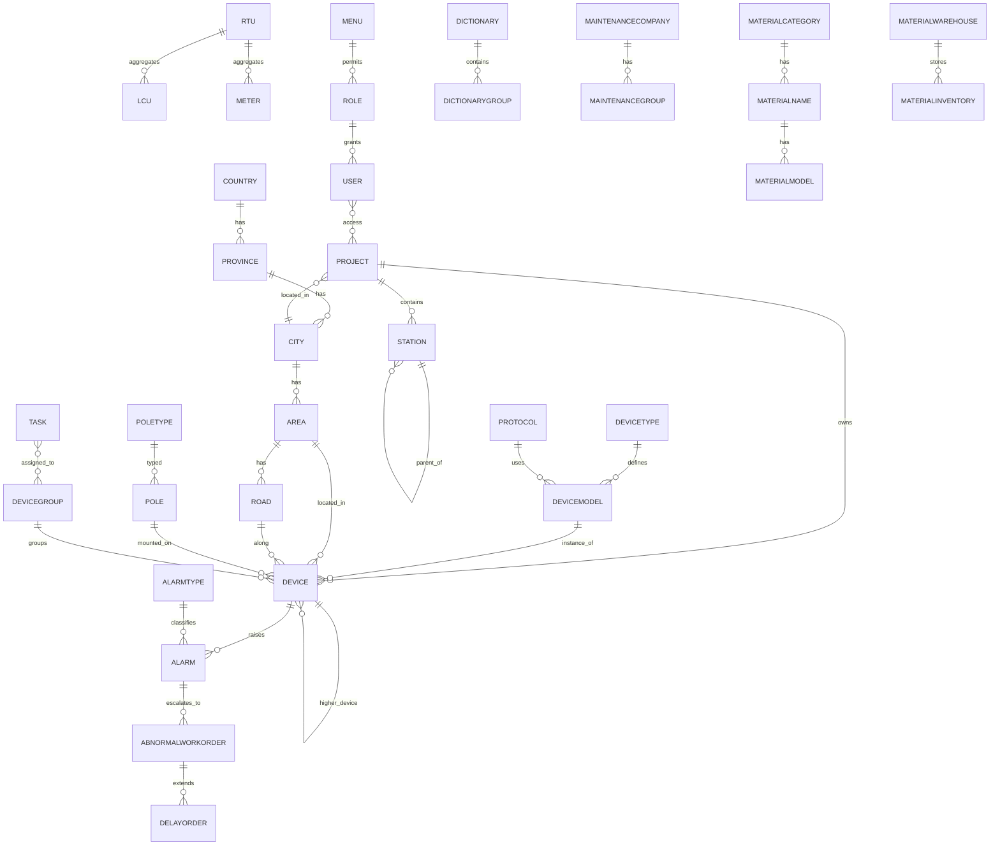

# SLCP — Kiến trúc & quan hệ dữ liệu

## 1. Kiến trúc tổng thể

```
┌─────────────────────────┐        ┌──────────────────────────────┐        ┌──────────────┐
│  Frontend (Vue SPA)     │  HTTP  │  Backend REST API            │        │  Database    │
│  http://159.138.45.45:81│ ─────► │  http://159.138.45.45:18080  │ ─────► │  (ẩn sau API)│
│  Baidu Maps, Hikvision, │  JSON  │  /api/v1.0/<controller>/...  │        │              │
│  Luckysheet, jsencrypt  │ ◄───── │  CORS, trả JSON bọc chuẩn    │        │              │
└─────────────────────────┘        └──────────────────────────────┘        └──────────────┘
         ▲ ranh giới quan sát được từ trình duyệt dừng ở đây ─────────────┘
```

- **Frontend**: Vue SPA (Vue CLI build), router dạng hash (`#/...`), ~408 route khai báo, 43 hiển thị trong menu tài khoản HTest. Thư viện: Baidu Maps (bản đồ), Hikvision h5player/jsWebControl (camera), Luckysheet (báo cáo bảng), jsencrypt (RSA mã hoá lúc đăng nhập).
- **Backend**: REST API riêng tại cổng **18080**, version `v1.0`, bật CORS (có preflight `OPTIONS`). **Không TLS**.
- **Kênh realtime**: WebSocket `ws://159.138.45.45:81/clesws` (cùng host frontend). Lệnh điều khiển đi HTTP, trạng thái/đo lường/cảnh báo thiết bị về qua WS. Chi tiết frame ở `11-api-probe-and-security.md` mục 2.

```
Frontend ──HTTP POST (lệnh)──► Backend ──giao thức RF/CAT1──► Gateway ──► LCU/đèn
Frontend ◄──WebSocket /clesws (trạng thái, đo điện, cảnh báo realtime)── Backend
```

## 2. Quy ước API

- **Base**: `http://159.138.45.45:18080/api/v1.0/` + `<controller>/<method>`. (Menu/đăng nhập ở `/api/...` không có `v1.0`.)
- **Method**: chủ yếu `POST` cả cho truy vấn (1.880 POST, 401 GET, 16 PUT, 23 DELETE). Query/list thường là `POST` với body JSON.
- **Quy ước đặt tên method**: `query*`/`page*`/`*List`/`get*` = đọc; `save` = thêm; `update` = sửa; `delete`/`deleteDeviceBatch` = xoá; `import`/`export`; `*Ctrl`/`*Control`/`issue`/`send*` = điều khiển/hạ lệnh xuống thiết bị.
- **Response bọc chuẩn**:
  ```json
  { "type": true, "code": 200, "message": "...", "data": ... }
  ```
  `data` là object, mảng, hoặc trang: `{ records:[...], total, size, current, pages }`.
- **Tham số phân trang**: `current` (trang), `size` (số dòng/trang). Lọc thường kèm `projectId` + `integratedQuery` (ô tìm kiếm chung).
- **Ngôn ngữ**: mọi request kèm `?lang=en-US`.

## 3. Xác thực

- Đăng nhập dùng **jsencrypt (RSA)** để mã hoá thông tin phía client.
- Sau đăng nhập, mỗi request đính **token trong HTTP header** (không chỉ cookie). → Gọi API ngoài luồng app (fetch tay) bị từ chối vì thiếu token hợp lệ.
- `projectId` được frontend lưu ở `localStorage` (`pid`) và gắn vào hầu hết request → hệ thống **phân vùng dữ liệu theo dự án**.
- Menu/quyền theo vai trò: `GET /api/getSinglePageMenu/{menuId}/1` trả cây menu kèm `permit` (RBAC).

## 4. Định danh (ID)

- Khoá chính dạng **chuỗi hex 32 ký tự** (UUID bỏ dấu gạch), ký hiệu `id32` trong tài liệu. Ví dụ `projectId = 9a59bd490ce14e139948fbda5addb2df`.
- Một số bảng log/cảnh báo dùng `id` kiểu số tăng dần.
- Giá trị enum lưu dạng **số** (`dictValue`), nhãn hiển thị tra từ bảng dictionary (xem `05-dictionaries.md`).

## 5. Phân cấp địa lý & tổ chức

```
Country → Province → City → Area(khu vực) → Road(tuyến đường)
Project (dự án) ── gắn vào Country/Province/City, có timezone, toạ độ, cấu hình điều khiển sáng
   └── Station (cây thư mục/trạm, có parentId → phân cấp cha-con)
        └── Device (thiết bị, gắn Area + Road + Pole)
```

Project là gốc vận hành: mọi thiết bị, tác vụ, cảnh báo, báo cáo đều mang `projectId`. Bảng `project` rất rộng (xem `03-entities.md`) — chứa cấu hình giờ bật/tắt, lệch mùa (summer/winter time), chế độ điều khiển sáng (`lightCtrlMode`), ngưỡng tỉ lệ online, chế độ tác vụ…

## 6. Trục quan hệ trung tâm: Thiết bị

```
DeviceType (7 loại)
   └── DeviceModel (model cụ thể, vd LCU-RF-HAPU)
        │  - gắn Protocol (vd RF/F2, CAT1/F2, Gateway/SDMP, TCP/D-light)
        │  - deviceConfig: bộ thuộc tính kỹ thuật theo loại (công suất, số mạch, mức dim…)
        └── Device (thiết bị thực tế)
             - UID, ICCID, trạng thái enable, trạng thái đăng ký (registerStatus)
             - gắn Area + Road + RoadDirection(side) + Pole
             - ctype / superDeviceType: phân nhánh IOT / Non-IOT
             - higherDevice: thiết bị cấp trên (quan hệ cha-con giữa thiết bị)
```

Thiết bị liên kết với nhau theo **topo** (`rtuActor`, `equipmentCorrelation`): ví dụ LCU/công tơ gắn (associate) vào RTU — thấy rõ ở các endpoint `lcuActor/associateLcuWithRtu`, `meterActor/associateUserMeterWithRtu`.

## 7. Trục Tác vụ (điều khiển chiếu sáng)

```
Task (mẫu tác vụ: bật/tắt, dim theo giờ hoặc theo mặt trời mọc/lặn)
   └── DeviceGroup (nhóm thiết bị) ── gắn Task ──► hạ xuống thiết bị (taskIssue / *Ctrl)
Strategy Grouping / LinkageStrategy: nhóm & chiến lược liên động (vd theo cảm biến, radar, AIBox)
```

Task có lịch phong phú: `executeModel` (theo giờ cố định / theo mặt trời), `sunsetFrontOffset`, `sunriseBackDim`, `dimValue`, `loopType`, `cycle`…

## 8. Trục Cảnh báo & Phiếu công việc

```
Alarm (realtime: config/getAlarmPage ; lịch sử: config/getAlarmHisPage)
   - gắn Device, có alarmType, level, source (thủ công/tự động/model), followUpStatus
   └── Abnormal / AbnormalWorkOrder (phiếu công việc) → DelayOrder (gia hạn)
AlarmType: danh mục loại cảnh báo theo từng loại thiết bị
```

## 8b. Lớp điều khiển (gửi lệnh xuống thiết bị)

Ngoài các controller đọc/ghi DB, có nhóm controller tên `*Ctrl`/`*Control` (lớp **C** trong `04-api-catalog.md`) **gửi gói tin xuống thiết bị thật** qua gateway:
- Điều khiển đèn: `lampControl` (unicast/group/broadcast: bật, tắt, dim, hỏi trạng thái/dữ liệu).
- Nạp lịch: `lcuTaskCtrl`, `rtuTaskCtrl`, `taskCtrl`, `smartBoxTaskCtrl`… (nạp/xoá/hỏi task trên thiết bị).
- Đóng cắt: `kmControl` (contactor theo đơn/nhóm/dự án).
- Cấu hình phần cứng từ xa: `gatewayControl`, `powerBoxControl`, `dtuControl`, `smartBoxControl`…
- Hỏi thiết bị: `meterControl/query*`, `*Ctrl/queryStatus` — **gửi gói tin hỏi**, không phải đọc DB (lưu ý khi dò).

Đặc điểm: HTTP trả “accepted” ngay (`Operation succeeded`), kết quả thực thi thật về sau qua WebSocket. Xem `08-auth-and-reuse.md` (lệnh dimming đã test) và `10-task-behavior-qa.md` (hành vi).

## 9. Sơ đồ quan hệ thực thể (ERD — mức logic, suy luận)



> ERD ở mức logic, suy từ tên trường FK. Lực lượng (cardinality) là ước lượng hợp lý, không phải ràng buộc DB khai báo.

## 10. Luồng thêm / sửa / xoá dữ liệu

Ví dụ với **Thiết bị** và **Loại thiết bị** (quan sát trực tiếp trên form):

**Thêm thiết bị** — form `Add Equipment` (`#/equipment/terminal`):
- Trường: Project, Type, *Device Model, *Name, ID, *UID, Region(Area), Road, Side, Road Classification, *Status, Remark. (`*` = bắt buộc)
- Dropdown đổ từ API: DeviceModel theo Type, Area theo City, Road theo Area, các enum từ dictionary (Status key 26, registration key 70, road side key 34).
- Submit → `POST /v1.0/device/save` (xoá: `device/delete`/`deleteBatch`; đăng ký/huỷ: register/unregister).

**Thêm loại/model thiết bị** — form `Add Device Model` (`#/equipments/equipmentModel`):
- Trường chung: Project, *Type, *Function type/protocol, *Device Model, Picture, Remark.
- **Bộ trường cấu hình đổi theo Type** (chính là `deviceConfig`):
  - *Lamps*: Lamp Type, Power Type, Power protocol, Lamp Life(h), Rated/Actual/Apparent power, Rated/Actual current, Actual voltage, power factor
  - *LCU*: Lamp Number, Dimming Level
  - *Concentrator*: Concentrator Type
  - *Electric Meter*: Voltage Rate, Current Rate, Meter Type
  - *Gateway*: Gateway Type
  - *Lamp Pole*: Pole Type, Arm Type
  - *Switch and detection*: Producer, Number Of Circuits, Digital/Analog Road Number
- Submit → `POST /v1.0/deviceModel/save` (sửa `update`, xoá `delete`, copy).

**Quy luật chung**: mỗi màn hình list có nút Add/Delete/Import/Export; "thêm/bớt loại dữ liệu" = gọi `save`/`update`/`delete` của controller tương ứng, luôn kèm `projectId`. Giá trị enum chọn từ dictionary, quan hệ chọn từ các API list của thực thể cha.
