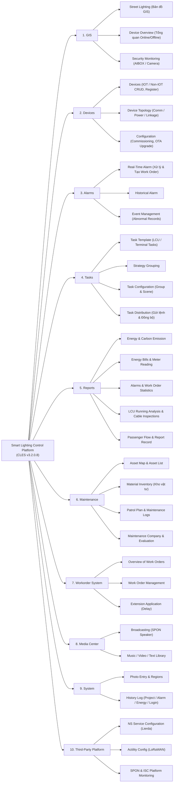
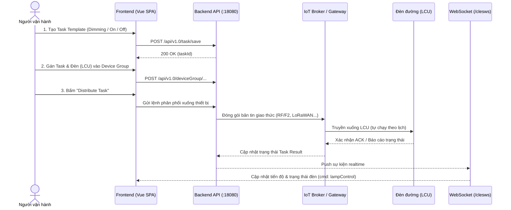

---
tags:
  - smart-lighting
  - functional-map
  - mermaid
created: 2026-11-19
---

# 01 - Sơ đồ Chức năng (Functional Map)

Quay lại: [[00 - Smart Lighting Control Platform (MOC)]]

Hệ thống **Smart Lighting Control Platform** gồm **10 phân hệ chính** trên thanh điều hướng (tổng cộng 403 route cấu hình trong Vue Router phân quyền động qua `store.state.permission.routes`).

## 1. Sơ đồ Phân rã Chức năng (Functional Architecture)

## 2. Chi tiết Chức năng từng Phân hệ (Qua kiểm thử thực tế)

| Phân hệ | Màn hình (Route) | Tính năng & Hành động chính (Buttons / Tabs) |
| :--- | :--- | :--- |
| **1. GIS** | `Street Lighting` (`#/gis/index`) | Bản đồ Google/Baidu Maps, điều khiển theo Project/Group/Frame Selection/Scenes, lọc thiết bị (Concentrator, LCU, Gateway, CABLE), xem tủ điện (View Cabinet), thống kê cảnh báo realtime |
| | `Device Overview` (`#/commissioning/index`) | Dashboard tổng quan số lượng Enable/Online/Offline theo Concentrator, LCU, Gateway, Pole; thống kê thay thế & hỏng đèn/driver theo Tuần/Tháng/Năm |
| | `Security Monitoring` (`#/gis/securityMonitoring`) | Giám sát thiết bị AIBOX & danh sách sự kiện an ninh |
| **2. Devices** | `Devices` (`#/equipment/terminal`) | Quản lý thiết bị IOT & Non-IOT: Add, Delete, Register, Unregister, Initial Deployment, Import/Export Excel, UID Change Records, Device Model |
| | `Device Topology` (`#/equipmentCorrelation`) | 5 góc nhìn topo: Communication Topology, Power Supply Topology, Assembly Association, Device Linkage, Quick Binding |
| | `Configuration` (`#/commissioning/rtu`) | Cấu hình tham số (Edit Parameter), OTA Upgrade, LCU Upgrade Query, Routing Configuration, Active collection settings, Issue lệnh |
| **3. Alarms** | `Real-Time Alarm` (`#/alarmRealTime`) | Theo dõi cảnh báo chưa xử lý, Alarm Handling, Dispatch Work Order (tạo phiếu sửa chữa từ cảnh báo), Export |
| | `Historical Alarm` (`#/alarmHistorys`) | Tra cứu lịch sử cảnh báo, Clear Alarm Record, Export |
| | `Event Management` (`#/abnormalManagement`) | Quản lý sự kiện bất thường *(Lưu ý: API `queryAbnormalRecordPage` đang báo lỗi `500`)* |
| **4. Tasks** | `Task Template` (`#/policyManage/taskManage`) | Tạo/Sửa/Xóa mẫu lịch trình (`LCU Self-Running Task`, `Terminal Tasks`), hỗ trợ Execute by Time / Sunrise-Sunset, Dimming, Turn On/Off, Import/Export |
| | `Strategy Grouping` (`#/strategicGrouping`) | Gom nhiều Task Template thành nhóm chiến lược |
| | `Task Configuration` (`#/policyManage/index`) | Gán Thiết bị (Device List) + Nhiệm vụ (Task List) vào Group, cấu hình Road/Facade Scene, Distribute Task |
| | `Task Distribution` (`#/policyManage/taskIssue`) | Theo dõi trạng thái gửi lệnh (To Be Distributed, Task Result, Fail count), gửi tham số ánh sáng, kinh/vĩ độ, Group Number, Clear Self-Running Task |
| **5. Reports** | `Energy` (`#/statisticAnalysis/index`) | Thống kê điện năng tiêu thụ & lượng phát thải Carbon (Carbon Emission), cấu hình điện năng cơ bản |
| | `Energy Bills` (`#/billStatistics/index`) | Thống kê hóa đơn tiền điện & lịch sử đọc công tơ (Meter Records) |
| | `Alarms`, `Work Orders`, `LCU Analysis`, `Cable`, `Passenger Flow`, `Report Record` | Hệ thống báo cáo đa chiều & tự động sinh báo cáo định kỳ (Auto Settings, Generate Report) |
| **6. Maintenance** | `Asset Map` & `Asset List` | Bản đồ tài sản & Sổ cái tài sản (Asset Ledger), Import/Export |
| | `Material` (`#/productionCenter/materialManagement`) | Quản lý kho vật tư: Nhập kho (Stock-In), Xuất kho (Picking), Mua sắm (Purchase), Danh mục |
| | `Patrol Plan`, `Facility Planning`, `Maintenance Company`, `Logs`, `Evaluation` | Kế hoạch tuần tra, nhà thầu bảo trì, nhật ký và đánh giá KPI (tỷ lệ đèn sáng, tỷ lệ sửa chữa) |
| **7. Workorder** | `Overview`, `Work Order`, `Extension Application` | Tổng quan vòng đời phiếu công việc, quản lý phiếu bảo trì, duyệt gia hạn (Delay) |
| **8. Media Center** | `Broadcasting`, `Music`, `Video`, `Text Library` | Phát thanh công cộng qua loa SPON, quản lý kho tệp âm thanh/video/văn bản (đẩy lên màn hình LED/loa) |
| **9. System** | `Photo Entry`, `Regions`, `History Log` | Quản lý ảnh/quy tắc hiển thị đồ họa, phân vùng hành chính (Country/Province/City/Area), nhật ký hệ thống (Project Log, Login Log, AIBOX Log) |
| **10. Third-Party** | `NS Service`, `Actility`, `SPON`, `ISC` | Cấu hình tích hợp Lierda Network Server, Actility LoRaWAN (Domain, Group Number, Freq, FW Query), SPON PA & Hikvision ISC |

## 3. Luồng Nghiệp vụ Cốt lõi: Giao Task xuống Đèn (Task Lifecycle)

