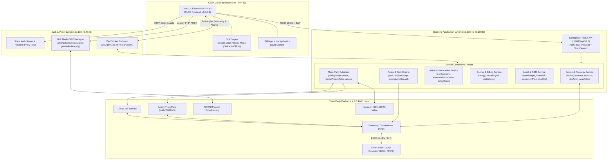

---
tags:
  - smart-lighting
  - system-design
  - architecture
  - mermaid
created: 2026-11-19
---

# 02 - Kiến trúc Hệ thống (System Design)

Quay lại: [[00 - Smart Lighting Control Platform (MOC)]]

## 1. Sơ đồ Kiến trúc Tổng thể (High-Level Architecture)



## 2. Phân tích Thành phần Kỹ thuật (Tech Stack)

### A. Frontend Architecture (`http://159.138.45.45:81/`)
- **Framework**: Vue 2 SPA (Hash Router `#/...`), giao diện **Element UI**, quản lý trạng thái tập trung bằng **Vuex** với 14 modules:
  `alarm`, `app`, `device`, `energy`, `errorLog`, `map`, `media`, `permission`, `router`, `settings`, `statusBar`, `tagsView`, `user`, `websocket`.
- **Phân quyền động (Dynamic RBAC)**:
  - Menu và quyền nút bấm từng trang được tải động qua `GET /api/getSinglePageMenu/{menuId}/1`.
  - Hỗ trợ `tagsView` (mở nhiều tab nội bộ song song trong SPA).
- **GIS & Visualization**:
  - Hỗ trợ đa nền tảng bản đồ (**Google Maps API v3** và **Baidu Maps v3.0 + Heatmap + MarkerClusterer + Offline BMap**).
  - Tích hợp **Luckysheet** (xem/sửa bảng tính báo cáo trực tiếp trên web), **h5player.min.js** & **jsWebControl** (phát luồng camera an ninh ISC/Hikvision), **JSEncrypt** (mã hóa RSA phía client khi đăng nhập).
- **Lưu trữ phía Client**:
  - `sessionStorage`: Lưu `token` (JWT), `language`, `logoData`, `mapModel`.
  - `localStorage`: Lưu cấu hình cột hiển thị của bảng theo từng user + project + phiên bản (`{userId}-{projectId}-{module}-{version}`), trạng thái bản đồ (`lat`, `lng`, `mapMode`), cache danh sách `projectTree` / `projectInfos`.

### B. Backend Architecture (`http://159.138.45.45:18080/`)
- **Nền tảng**: Java Spring Boot (nhận diện qua cấu trúc lỗi chuẩn Spring Boot `{"timestamp", "status", "error", "path"}` và cookie `JSESSIONID` + `rememberMe=deleteMe` đặc trưng của **Apache Shiro** kết hợp **JWT HS256**).
- **Kiến trúc Actor/Controller theo loại thiết bị**:
  - Mỗi loại thiết bị IoT có một Actor/Controller riêng biệt: `lcuActor`, `rtuActor`, `luxActor`, `cameraActor`, `smartBoxActor`, `solarActor`, `solarLcuActor`, `dtuActor`, `wcuActor`, `meterActor`.
- **Dịch vụ phụ trợ (Legacy PHP)**:
  - Các tính năng âm thanh công cộng SPON gọi trực tiếp qua proxy PHP trên cổng `81` (`/php/getsetzonedata.php`, `/php/getmediadata.php`).

### C. Bảo mật & Ngữ cảnh Request (Security & Multi-Tenancy)
Mỗi request API đều mang theo đầy đủ ngữ cảnh **Multi-Project / Multi-Timezone**:
- **JWT Payload (HS256)** giải mã được:
  ```json
  {
    "exp": 1795056767,
    "clientType": "web",
    "currentTimeMillis": "1795053167231",
    "jwt_claim_agencyId": "0a9ea73e0ac54958933efca54425862d",
    "userGroup": "3",
    "account": "Nha"
  }
  ```
- **Context Headers bắt buộc**: `authorization`, `projectid`, `useraccount`, `clienttype`, `timezone` (`UTC+7:00`), `offset`, `summertimestartlong`, `summertimeendlong`.
- **CORS**: Cho phép `http://159.138.45.45:81` gọi sang `:18080` với các method `GET, POST, OPTIONS, PUT, DELETE`.

## 3. Điểm cần lưu ý về Vận hành & Bảo mật
1. **Truyền tải HTTP/WS chưa mã hóa TLS**: Cả cổng `81` (Web + WebSocket) và `18080` (API mang JWT) đang chạy trên `http://` và `ws://` thuần.
2. **Lỗi 500 trên phân hệ Event Management**: Endpoint `POST /api/v1.0/abnormalRecord/queryAbnormalRecordPage` hiện đang trả về `500 Internal Server Error` cần kiểm tra log phía server Spring Boot.
3. **Bản tin WebSocket Broadcast rộng**: WebSocket `/clesws` đẩy về trình duyệt bản tin telemetry của **nhiều `projectId` khác nhau** (không chỉ project đang chọn `Demo H`), cần lưu ý lọc dữ liệu ở tầng server để tối ưu băng thông và bảo mật multi-tenant.
