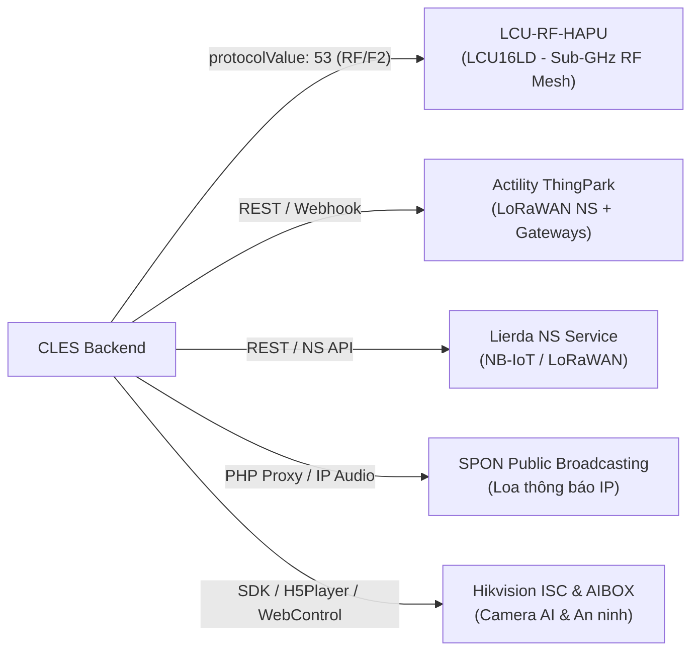

---
tags:
  - smart-lighting
  - protocol
  - websocket
  - iot
created: 2026-11-19
---

# 04 - Giao thức & WebSocket Protocol

Quay lại: [[00 - Smart Lighting Control Platform (MOC)]]

## 1. WebSocket Real-time Protocol (`ws://159.138.45.45:81/clesws`)

Frontend duy trì một kết nối WebSocket liên tục trong Vuex module `store.state.websocket.websock` (`readyState: 1 / OPEN`) để nhận dữ liệu Telemetry, trạng thái bật/tắt/dimming của đèn, trạng thái kết nối Gateway/RTU và cảnh báo sự cố theo thời gian thực.

### Cấu trúc Khung bản tin chuẩn (Envelope)
```json
{
  "code": 200,
  "type": true,
  "message": "操作成功!",
  "data": {
    "cmd": "<module_command>",
    "ctrl": "<sub_action>",
    "projectId": "<uuid>",
    "data": { ... }
  }
}
```

### Các loại Bản tin (`cmd` + `ctrl`) đã thu thập thực tế

#### 1.1. Trạng thái bật/tắt & độ sáng đèn (`cmd: "lampControl"`, `ctrl: "status"`)
```json
{
  "cmd": "lampControl",
  "ctrl": "status",
  "projectId": "85b9df42fe2443998d1255980fe2a38c",
  "data": {
    "deviceId": "0820256402D8",
    "poleId": "8205baedde8444fb815d4d95da4b58d8",
    "lotime": 1795054154618,
    "lampStatus": [
      { "num": 1, "ls": 1, "dimming": 5 }
    ]
  }
}
```
- `num`: Kênh đèn (1 = Đèn đơn / tay đèn 1).
- `ls`: Lamp Status (`1` = Bật/Sáng, `2` = Tắt).
- `dimming`: Độ sáng từ `0` đến `100` (%).

#### 1.2. Dữ liệu đo lường điện năng LCU (`cmd: "lampControl"`, `ctrl: "data"`)
```json
{
  "cmd": "lampControl",
  "ctrl": "data",
  "projectId": "4928ba90bb16498f8b3ec342c63b695f",
  "data": {
    "deviceId": "044024A402CC",
    "lcuData": [
      {
        "num": 1,
        "dtime": "2026-11-19 07:54:14",
        "voltage": 229.74,
        "current": 0.00010,
        "power": 0.0,
        "powerFactor": 0.0,
        "energy": 513098.1875,
        "devicent": 32.58,
        "leakageVoltage": 0.0,
        "leakageCurrent": 0.0,
        "lux": 0,
        "angle": 0,
        "life": 15777765,
        "fault": 0,
        "lastSource": 1,
        "lastAction": 16
      }
    ]
  }
}
```
| Trường | Ý nghĩa | Đơn vị |
| :--- | :--- | :--- |
| `voltage` / `current` | Điện áp / Dòng điện | V / A |
| `power` / `powerFactor` | Công suất tác dụng / Hệ số công suất (PF) | W / `0..1` |
| `energy` | Điện năng tiêu thụ tích lũy | Wh |
| `devicent` | Nhiệt độ nội bộ thiết bị LCU | °C |
| `leakageVoltage` / `leakageCurrent` | Điện áp rò / Dòng rò (chống giật) | V / mA |
| `angle` | Góc nghiêng cột đèn (cảm biến gia tốc) | Độ (°) |
| `life` | Tổng thời gian hoạt động tích lũy | Giây |

#### 1.3. Tổng hợp trạng thái Cột đèn (`cmd: "pole"`, `ctrl: "lampStatus"`)
```json
{
  "cmd": "pole",
  "ctrl": "lampStatus",
  "projectId": "4928ba90bb16498f8b3ec342c63b695f",
  "data": [
    { "poleId": "afe95089fc7e4a84a3dcfe0104d28541", "lampCount": 4, "lightCount": 0 }
  ]
}
```

#### 1.4. Trạng thái Concentrator / RTU (`cmd: "rtu"`, `ctrl: "status"`)
```json
{
  "cmd": "rtu",
  "ctrl": "status",
  "projectId": "0eb6f707938b452cbacd5d0a3602870a",
  "data": {
    "deviceId": "0F10226007BE",
    "signals": 90,
    "netWorkStatus": 1,
    "communicationModel": 1,
    "stime": "2026-11-19 09:09:15"
  }
}
```

#### 1.5. Đẩy Cảnh báo Thời gian thực (`cmd: "push"`, `ctrl: "alarm"`)
```json
{
  "cmd": "push",
  "ctrl": "alarm",
  "projectId": "85b9df42fe2443998d1255980fe2a38c",
  "data": {
    "deviceId": "e9c2264cd3fd45af8866bb551c9a06bb",
    "deviceName": "90w-LAMER#1-P17-R",
    "uid": "045024B0009C",
    "deviceTypeValue": 2,
    "alarmType": 598,
    "level": "1",
    "color": "#FF0000",
    "errorBelong": "LAMP1",
    "reset": "Y",
    "firstTime": 1795003471811,
    "cTime": 1795054155377,
    "alarmRealValue": "{\"p\":13.44,\"te\":0.0,\"u\":243.86,\"pf\":0.73,\"lc\":null,\"i\":\"0.075\",\"angle\":0,\"lv\":0.0,\"time\":\"2026-11-19 05:47:58\"}"
  }
}
```

---

## 2. Giao thức Phần cứng IoT & Tích hợp Bên thứ 3



| Giao thức / Nền tảng | Mã / Nhận diện | Ứng dụng trong hệ thống |
| :--- | :--- | :--- |
| **RF/F2** | `protocolValue: "53"`, `ctype: 53` | Giao tiếp vô tuyến cho dòng `LCU-RF-HAPU` (`LCU16LD`) trong project `Demo H`. Hỗ trợ lịch tự chạy nội bộ (`LCU Self-Running Task`), cấu hình kinh/vĩ độ (Sunrise/Sunset), Group Number. |
| **Actility ThingPark** | `/api/v1.0/actilityProjectActor/*` | Quản lý hạ tầng LoRaWAN: Domain Configuration, Group Number, tần số truyền (transmission frequency), FW Query, Status Query, đồng bộ Tag. |
| **Lierda NS Service** | `/api/v1.0/lierdaProjectActor/*` | Tích hợp Network Server của Lierda (NB-IoT / LoRa), truy vấn Firmware & tọa độ GPS. |
| **SPON Broadcasting** | `/php/getsetzonedata.php`, `/php/getmediadata.php` | Điều khiển loa phát thanh công cộng theo vùng (Zone), nghe thử (Audition) và đồng bộ thư viện nhạc/giọng nói. |
| **Hikvision ISC / AIBOX** | `h5player.min.js`, `jsWebControl`, `/api/v1.0/aibox/*` | Giám sát video trực tiếp, phân tích sự kiện AI (AIBOX Event) và đếm lưu lượng người (Passenger Flow). |
