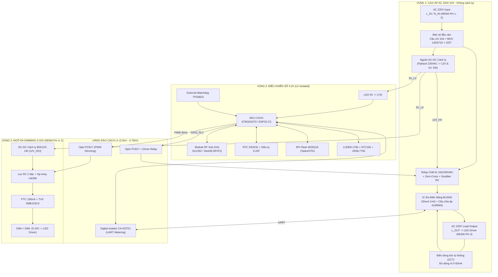

---
tags:
  - smart-lighting
  - hardware
  - schematic
  - lcu
  - bom
created: 2026-11-20
---

# 05 - Thiết kế Phần cứng LCU Thực tế (Hardware Schematic)

Quay lại: [[00 - Smart Lighting Control Platform (MOC)]]

Thiết kế mạch điện tử công nghiệp đề xuất cho bộ điều khiển đèn đường **LCU (`LCU-RF-HAPU` / chuẩn đế NEMA 7-pin ANSI C136.41)** đáp ứng đầy đủ các thông số Telemetry, Điều khiển & Bảo vệ thu thập được từ nền tảng CLES.

## 1. Kiến trúc 3 Vùng Cách ly Điện áp (Isolation Architecture)



## 2. Sơ đồ Nguyên lý Chi tiết từng Khối

### 2.1. Khối Nguồn AC 220V, Chống sét, Relay 16A & Đo điện năng (`BL0942`)
```text
L_IN (220VAC) ──[F1: 10A/250V]──┬──[MOV1: 14D471K]──┬── N_IN
                                │                   │
                                │  [RLY1: 16A/250V] │
                                └─── COM ──o/ o── NO ──┬──[R_shunt: 1mΩ 2W]──┬── L_OUT (Tới LED Driver)
                                     │                 │                     │
                                     └─[100Ω + 0.1uF]──┘ (RC Snubber)
                                                       │                     │
                                                  IP+ (BL0942)          IP- (BL0942)
                                                       │
               L_OUT ──[390kΩ]──[390kΩ]──[390kΩ]──[390kΩ]──┬── VP (BL0942)
                                                           └──[1kΩ]── GND_HV (N_IN)

               BL0942 (UART 4800bps) ══[CA-IS3721]══> UART MCU (3.3V)
```

### 2.2. Khối Chuyển đổi `PWM 3.3V` → `0–10V` Cách ly (Dimming LED Driver)
```text
                                            +12V_ISO (B0512S-1W)
                                                │
                                              [R2: 4.7kΩ]
                                                │
MCU_PWM (2kHz) ──[R1: 470Ω]──► LED [PC817] C ───┴──[R3: 10kΩ]──┬──[R4: 10kΩ]──┬──► (+) LM358
                                   Opto    E                   │              │         │
                                           │                 [C1: 1uF]      [C2: 1uF]   ├──► (─) LM358
                                        GND_ISO                │              │         │
                                                            GND_ISO        GND_ISO      └──[R5: 100Ω]──[PTC]──► DIM+ (0-10V)
                                                                                                         │
                                                                                                    [TVS 15V]
                                                                                                         │
                                                                                                      GND_ISO ──► DIM-
```

### 2.3. Khối Đo Dòng rò (Leakage Current - ZCT)
```text
L_OUT ──┐
        │  (Dây L & dây N cùng đi qua biến dòng thứ tự không ZCT 1000:1)
N_OUT ──┘
        ║  Cuộn thứ cấp ZCT
        ╠══[R_burden: 100Ω]══┬──[BAT54S]──► Op-Amp Khuếch đại & Chỉnh lưu ──► ADC MCU
        ╚════════════════════┴── Vref (1.65V)
```

## 3. Quy tắc Layout PCB An toàn Điện áp Cao (IPC-2221)
1. **Khoảng cách cách ly (Creepage / Clearance):** Giữa vùng `HV (220VAC)` và vùng `LV (3.3V)` phải giữ khoảng cách tối thiểu **≥ 6.4 mm** (nên phay rãnh không khí *air-slot* rộng `2mm` ngay dưới thân Opto `PC817` và `CA-IS3721`).
2. **Đường mạch công suất (`L_IN → Relay → Shunt → L_OUT`):** Độ rộng đồng tối thiểu `4–5mm` với lớp đồng `2oz` (hoặc phủ thiếc hở *solder mask opening*) để chịu tải `16A` và dòng xung khởi động (inrush current) của LED Driver.
3. **Kỹ thuật Kelvin Sensing cho điện trở Shunt `1mΩ`:** Hai đường mạch `IP+` và `IP-` phải đi song song sát nhau (differential pair) trực tiếp từ 2 chân trong của điện trở Shunt về IC `BL0942` để tránh sai số đo dòng điện.
4. **Siêu tụ cho RTC thay vì pin Lithium:** Trên đỉnh cột đèn ngoài trời nắng nhiệt độ hộp kín có thể đạt `65–75°C`, dùng siêu tụ `0.22F/5.5V` giữ giờ RTC 3–7 ngày khi mất điện sẽ an toàn và bền tuổi thọ 10 năm hơn pin cúc áo.

## 4. Bảng BOM Linh kiện Dự kiến

| Khối | Linh kiện đề xuất | Ước tính (USD) |
| :--- | :--- | :---: |
| Nguồn AC-DC cách ly | `HLK-5M12` / Flyback `LNK306` + `B0512S-1W` | \$2.20 |
| Đóng cắt công suất | Relay chốt từ `HF161F 16A/250VAC` + MOV `14D471K` + Cầu chì `10A` | \$1.50 |
| Đo điện năng & Dòng rò | `BL0942` + Shunt `1mΩ 2W` + ZCT `DL-CT08CL` + `CA-IS3721` | \$2.30 |
| Dimming 0–10V cách ly | `PC817` + `LM358` + `TVS SMBJ15CA` + `PTC` | \$0.60 |
| MCU + Bộ nhớ + RTC | `STM32G070CBT6` (hoặc `ESP32-C3`) + `W25Q16` + `DS3231` + Siêu tụ | \$3.50 |
| Truyền thông RF/F2 | Module `SX1262` (Sub-GHz LoRa/FSK) + Anten | \$4.00 |
| Cảm biến & Đế NEMA | `LIS3DH` + `VEML7700` + `NTC 10k` + Đế NEMA 7-pin | \$2.90 |
| **Tổng BOM ước tính** | *(Chưa gồm vỏ IP66 & PCB)* | **~\$17.00** |
